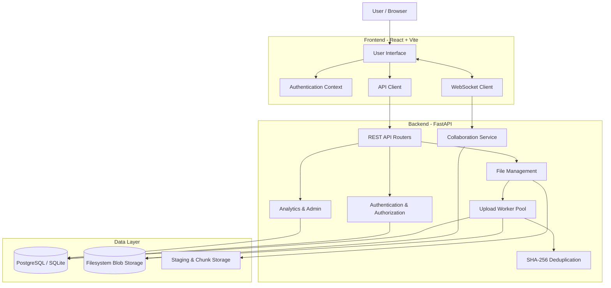

# CoreVault — Secure Cloud Storage & File Management Platform

<p align="center">
  <strong>A secure, multi-user cloud storage platform with intelligent storage management, collaboration, and file version control.</strong>
</p>

<p align="center">
  <a href="https://corevault-s9wr.onrender.com/app">Live Application</a> ·
  <a href="https://corevault-s9wr.onrender.com/health">API Health</a>
</p>

---

## Table of Contents

- [Overview](#overview)
- [Live Demo](#live-demo)
- [Key Features](#key-features)
- [Technology Stack](#technology-stack)
- [System Architecture](#system-architecture)
- [Database Design](#database-design)
- [Core Computer Science Concepts](#core-computer-science-concepts)
- [Project Structure](#project-structure)
- [Local Installation and Setup](#local-installation-and-setup)
- [Environment Variables](#environment-variables)
- [API Documentation](#api-documentation)
- [Deployment Architecture](#deployment-architecture)
- [Security](#security)
- [Future Scope](#future-scope)

---

## Overview

CoreVault is a multi-user cloud storage and file management platform designed to provide secure, efficient, and collaborative file management.

The platform combines conventional cloud storage functionality with important computer science concepts involving operating systems, database management systems, concurrency, networking, and information security.

Unlike a basic file storage application, CoreVault incorporates content-based deduplication, concurrent upload processing, file version management, permission-based collaboration, storage analytics, and activity tracking.

### Objectives

- Provide secure user authentication and file management.
- Support efficient file storage through content-addressable deduplication.
- Maintain file history and enable version restoration.
- Implement controlled file and folder sharing.
- Handle concurrent uploads while maintaining storage quota consistency.
- Provide insights into storage consumption and usage patterns.
- Demonstrate practical applications of OS and DBMS concepts.

## Live Demo

**Application:** https://corevault-s9wr.onrender.com/app

The deployed application provides access to the CoreVault frontend and its connected backend services.

---

## Key Features

### 1. User Authentication and Account Security

- User registration and login.
- JWT-based authentication.
- Secure password hashing using bcrypt.
- Time-based One-Time Password (TOTP) two-factor authentication.
- QR-code-based authenticator setup.
- Login attempt tracking and temporary account lockout after repeated failed attempts.
- Protected routes and authenticated API requests.

### 2. File Management

- Upload and download files.
- Organize files into nested folders.
- Create, rename, and delete folders.
- File browsing with folder navigation and breadcrumbs.
- Support for both single-request and chunked file uploads.
- Upload progress tracking.
- File metadata and size information.

### 3. Chunked File Upload

Large files are divided into smaller chunks and uploaded independently.

The upload workflow consists of:

1. Initializing an upload session.
2. Splitting the file into chunks.
3. Uploading each chunk individually.
4. Tracking acknowledged chunks.
5. Finalizing the upload after all chunks have arrived.

The frontend automatically selects the upload method based on file size.

### 4. Content-Based Deduplication

CoreVault implements SHA-256-based content-addressable storage.

- Every uploaded file is assigned a SHA-256 content hash.
- Files with identical content share the same physical storage blob.
- Blob reference counts track how many file versions refer to stored content.
- Duplicate uploads avoid unnecessary disk writes.
- Storage usage is accounted for separately for each user.

This reduces redundant physical storage consumption.

### 5. File Versioning

- Maintain multiple versions of a file.
- Preserve previous versions when a file is updated.
- Display version history.
- Restore an earlier version.
- Record modification timestamps and the modifying user.

### 6. Recycle Bin

- Soft-delete files instead of immediately removing their database records.
- View deleted files.
- Restore deleted files.
- Track deletion and scheduled purge timestamps.
- Configurable recycle-bin retention period.

*Note: The current implementation stores purge timestamps but does not yet run an automatic scheduled purge job.*

### 7. Sharing and Collaboration

CoreVault supports controlled file and folder access.

**Permission-based sharing:**
- Viewer: Read and download access.
- Editor: Editing access.
- Owner: Full ownership permissions.

Folder-level permissions are inherited by items within the folder through permission resolution.

**Public sharing:**
- Generate token-based shareable links.
- Configure viewer or editor access.
- Support link expiration.
- Configure maximum access counts.
- Revoke existing share links.

**Collaborative text editing:**
- Edit supported text-based files.
- WebSocket-based collaborative editing sessions.
- Broadcast document changes to connected collaborators.
- Use content hashes to detect conflicting edits.
- Save changes through the existing versioning and upload-finalization pipeline.

Supported text formats include TXT, Markdown, CSV, JSON, XML, HTML, CSS, JavaScript, TypeScript, Python, Java, C/C++, YAML, TOML, INI, LOG, SQL, and shell scripts.

### 8. Storage Analytics Dashboard

- Monitor storage consumption.
- View available and used storage quota.
- Analyse file types and storage distribution.
- Identify largest files.
- Review recently accessed files.
- Identify stale files based on access and modification history.
- Mark stale files to retain them.
- View storage growth forecasts based on historical data.

### 9. Administrative Dashboard

Administrative functionality includes:

- Overview of registered users.
- Aggregate storage usage information.
- User-level storage statistics.
- Individual user storage forecasts.

Administrative access is controlled through the `is_admin` database flag.

### 10. File Activity Tracking

CoreVault maintains an append-only activity history for file-related operations, including:

- File uploads.
- New versions.
- Downloads.
- File restoration.
- Deletion.
- Sharing changes.
- Anonymous downloads through public share links.

Users can review recent activity and individual file histories.

### 11. Storage Quota Management

- Configurable per-user storage quota.
- Track storage usage.
- Enforce quota limits during uploads.
- Synchronize concurrent quota updates using locks.
- Avoid charging additional physical storage for duplicate content belonging to an existing owner where applicable.

---

## Technology Stack

| Component | Technologies |
|---|---|
| Frontend | React 18, JavaScript, Vite |
| Styling | Tailwind CSS, PostCSS |
| Routing | React Router DOM |
| Backend | Python 3.11, FastAPI |
| API | REST APIs, WebSockets |
| ORM | SQLAlchemy 2.0 |
| Database | SQLite (local development), PostgreSQL (deployment) |
| Database Migrations | Alembic |
| Authentication | JWT, bcrypt, PyOTP |
| File Processing | Python, hashlib, python-multipart |
| Concurrency | ThreadPoolExecutor, threading locks, asyncio locks |
| File Locking | Portalocker |
| Frontend Deployment | Vercel |
| Backend Deployment | Render |
| Database Hosting | Supabase PostgreSQL |

---

## System Architecture

CoreVault follows a frontend-backend architecture with a relational database and filesystem-based blob storage.

### Architecture Diagram



### Request Flow

1. The user interacts with the React frontend.
2. The frontend sends HTTP requests to the FastAPI backend.
3. Authenticated requests include a JWT bearer token.
4. FastAPI validates authentication and permissions.
5. SQLAlchemy manages database interactions.
6. File operations interact with the filesystem-based storage layer.
7. Upload finalization is processed through a bounded worker pool.
8. WebSocket connections support collaborative editing.

---

## Database Design

CoreVault uses SQLAlchemy ORM models with relational constraints and Alembic migrations.

| Table | Purpose |
|---|---|
| `users` | User credentials, account status, storage quotas, 2FA settings and admin status |
| `folders` | Folder hierarchy and ownership |
| `files` | File metadata, ownership, current version and deletion state |
| `blobs` | Unique content hashes, storage paths, sizes and reference counts |
| `file_versions` | Historical file versions and modification information |
| `permissions` | File-level and folder-level access permissions |
| `shared_links` | Token-based public sharing configuration |
| `file_activity` | Append-only file activity and audit records |

### Important Relationships

- Each user can own multiple folders and files.
- Folders support nested structures through a self-referencing foreign key.
- Files can belong to folders or exist in the user's root directory.
- Multiple file versions can reference the same blob.
- Multiple files can share a blob when their content hashes match.
- Permissions can target either a file or a folder.
- Shared links reference individual files.
- File activity records reference the corresponding file and, when applicable, the acting user.

### Database Integrity

The implementation uses:

- Primary keys.
- Foreign keys.
- Unique constraints.
- NOT NULL constraints.
- CHECK constraints.
- Cascading deletion rules where appropriate.
- Database transactions.

In particular, the permissions table enforces that a permission record targets exactly one file or one folder.

---

## Core Computer Science Concepts

CoreVault incorporates several concepts from Operating Systems, DBMS, Algorithms, and Computer Networks.

### 1. Producer-Consumer Architecture

A bounded `ThreadPoolExecutor` handles upload finalization.

- Incoming upload requests act as producers.
- Worker threads act as consumers.
- Finalization jobs are submitted to the executor.
- Requests wait for their submitted job to complete.
- The bounded worker count controls the number of concurrent finalization tasks.

The worker pool uses a configurable number of threads through `UPLOAD_WORKER_THREADS`.

### 2. Mutexes and Concurrency Control

Two separate lock mechanisms protect critical operations.

**Content-hash locks**

Prevent two simultaneous uploads of identical new content from independently creating duplicate blobs.

**User-level locks**

Prevent concurrent uploads from losing storage quota updates through read-modify-write races.

Locks are acquired in a consistent order: content-hash lock followed by user lock.

### 3. File Locking

CoreVault uses Portalocker for cross-platform file locking.

Portalocker abstracts platform-specific locking mechanisms and provides a consistent Python interface across Windows, Linux, and macOS.

### 4. Content-Addressable Storage

Files are stored using their SHA-256 content hashes rather than relying exclusively on their original filenames.

This provides:

- Unique identification of file content.
- Efficient duplicate detection.
- Shared physical storage for identical content.
- Reference-count-based blob lifecycle management.

### 5. Chunked File Transfer

Large files are divided into smaller chunks to support incremental uploads.

The backend maintains filesystem-based upload-session metadata and tracks received chunks.

This avoids requiring the complete large file to be sent in a single request.

### 6. Database Transactions

Upload finalization coordinates database updates involving:

- File records.
- File versions.
- Blob records.
- Blob reference counts.
- User storage consumption.
- Activity history.

Transactions help maintain consistency across these related updates.

### 7. Referential Integrity

Foreign keys and database constraints maintain valid relationships between users, files, folders, versions, blobs, permissions, and activity records.

### 8. WebSocket Communication

WebSockets provide persistent, bidirectional communication for collaborative text editing.

Per-file asynchronous locks and base-hash checks help prevent conflicting document saves.

### 9. Soft Deletion

Instead of immediately deleting a file record, CoreVault marks it as deleted and records its deletion and purge timestamps.

This enables restoration through the recycle bin.

---

## Project Structure

```text
CoreVault/
│
├── backend/
│   ├── app/
│   │   ├── routers/
│   │   │   ├── auth.py
│   │   │   ├── files.py
│   │   │   ├── folders.py
│   │   │   ├── collaboration.py
│   │   │   ├── permissions.py
│   │   │   ├── recycle_bin.py
│   │   │   ├── shared.py
│   │   │   ├── analytics.py
│   │   │   ├── admin.py
│   │   │   └── system.py
│   │   │
│   │   ├── activity_log.py
│   │   ├── blob_release.py
│   │   ├── chunked_uploads.py
│   │   ├── config.py
│   │   ├── database.py
│   │   ├── deps.py
│   │   ├── file_activity.py
│   │   ├── main.py
│   │   ├── models.py
│   │   ├── otp.py
│   │   ├── ownership.py
│   │   ├── permissions.py
│   │   ├── schemas.py
│   │   ├── security.py
│   │   ├── storage.py
│   │   └── workers.py
│   │
│   ├── alembic/
│   │   └── versions/
│   │
│   ├── scripts/
│   ├── storage/
│   ├── requirements.txt
│   └── alembic.ini
│
├── frontend/
│   ├── public/
│   ├── src/
│   │   ├── api/
│   │   ├── components/
│   │   ├── context/
│   │   ├── lib/
│   │   ├── pages/
│   │   ├── App.jsx
│   │   ├── index.css
│   │   └── main.jsx
│   │
│   ├── package.json
│   ├── vite.config.js
│   └── vercel.json
│
├── .env.example
├── .gitignore
├── render.yaml
└── README.md
```

---

## Local Installation and Setup

### Prerequisites

Install the following:

- Python 3.11
- Node.js 18 or later
- npm
- Git

### 1. Clone the Repository

```bash
git clone <YOUR_GITHUB_REPOSITORY_URL>
cd CoreVault
```

### 2. Backend Setup

Navigate to the backend directory:

```bash
cd backend
```

Create a virtual environment:

```bash
python -m venv .venv
```

Activate it.

**Windows PowerShell:**

```powershell
.venv\Scripts\Activate.ps1
```

**Linux/macOS:**

```bash
source .venv/bin/activate
```

Install dependencies:

```bash
pip install -r requirements.txt
```

### 3. Configure the Database

For a simple local development setup, CoreVault supports SQLite.

Create a `.env` file in the project root with:

```env
DATABASE_URL=sqlite:///./corevault.db
DATABASE_SSL=false

JWT_SECRET=replace-with-a-long-random-secret
JWT_ALGORITHM=HS256
JWT_EXPIRE_MINUTES=60

MAX_FAILED_LOGIN_ATTEMPTS=5
LOCKOUT_MINUTES=15

STORAGE_ROOT=./storage
DEFAULT_STORAGE_QUOTA_BYTES=5368709120
```

SQLite tables are initialized automatically when the backend starts.

For PostgreSQL deployments, configure `DATABASE_URL` with your PostgreSQL connection string and apply the Alembic migrations:

```bash
alembic upgrade head
```

### 4. Start the Backend

From inside the `backend` directory:

```bash
uvicorn app.main:app --reload --port 8000
```

The backend will be available at:

```text
http://127.0.0.1:8000
```

Interactive API documentation:

```text
http://127.0.0.1:8000/docs
```

Health endpoint:

```text
http://127.0.0.1:8000/health
```

### 5. Frontend Setup

Open a second terminal and navigate to the frontend:

```bash
cd frontend
```

Install dependencies:

```bash
npm install
```

Create a `.env` file inside the frontend directory:

```env
VITE_API_URL=http://127.0.0.1:8000
```

Start the development server:

```bash
npm run dev
```

The frontend will generally be available at:

```text
http://localhost:5173
```

### 6. Build the Frontend

To create a production build:

```bash
npm run build
```

The generated production files will be placed in `frontend/dist/`.

---

## Environment Variables

### Backend

| Variable | Description |
|---|---|
| `DATABASE_URL` | SQLite or PostgreSQL connection URL |
| `DATABASE_SSL` | Enable SSL for PostgreSQL connections |
| `JWT_SECRET` | Secret used to sign JWT tokens |
| `JWT_ALGORITHM` | JWT signing algorithm |
| `JWT_EXPIRE_MINUTES` | Access token expiration time |
| `MAX_FAILED_LOGIN_ATTEMPTS` | Failed attempts allowed before lockout |
| `LOCKOUT_MINUTES` | Duration of temporary account lockout |
| `STORAGE_ROOT` | Root directory for uploaded files |
| `DEFAULT_STORAGE_QUOTA_BYTES` | Default user storage quota |
| `UPLOAD_WORKER_THREADS` | Number of upload-finalization workers |
| `SINGLE_SHOT_UPLOAD_MAX_BYTES` | Maximum size for single-request uploads |
| `UPLOAD_CHUNK_SIZE_HINT_BYTES` | Advisory chunk size |
| `RECYCLE_BIN_RETENTION_DAYS` | Recycle-bin retention configuration |
| `OTP_ISSUER_NAME` | Authenticator application issuer |
| `OTP_PENDING_TOKEN_EXPIRE_MINUTES` | Pending 2FA token expiration |
| `FRONTEND_URL` | Frontend origin used for share links and CORS |
| `CORS_ORIGINS` | Additional permitted frontend origins |
| `STALE_FILE_DAYS` | Days without access before stale-file review |
| `STALE_PROMPT_SNOOZE_DAYS` | Duration to snooze stale-file prompts |
| `ANALYTICS_TOP_FILES` | Number of largest files returned in analytics |
| `FORECAST_WINDOW_DAYS` | Historical window for storage forecasting |

The backend reads these additional settings through environment variables, with defaults defined in `backend/app/config.py`.

### Frontend

| Variable | Description |
|---|---|
| `VITE_API_URL` | Base URL of the CoreVault backend API |

**Important:** Never commit real `.env` files, database credentials, JWT secrets, or other sensitive configuration to GitHub.

---

## API Documentation

CoreVault exposes REST API endpoints through FastAPI.

The following table summarises the major endpoint groups.

| Module | Endpoint | Purpose |
|---|---|---|
| Authentication | `POST /auth/register` | Register a user |
| Authentication | `POST /auth/login` | Authenticate a user |
| Authentication | `GET /auth/me` | Retrieve current user |
| Authentication | `POST /auth/2fa/setup` | Generate 2FA setup |
| Authentication | `POST /auth/2fa/verify-setup` | Enable 2FA |
| Authentication | `POST /auth/2fa/verify` | Complete 2FA login |
| Folders | `POST /folders` | Create folder |
| Folders | `GET /folders/root` | Retrieve root folder |
| Folders | `GET /folders/{id}` | Retrieve folder contents |
| Folders | `PATCH /folders/{id}` | Update folder |
| Folders | `DELETE /folders/{id}` | Delete folder |
| Files | `POST /files/upload` | Upload a file |
| Files | `POST /files/upload/init` | Initialize chunked upload |
| Files | `POST /files/upload/{id}/chunk/{index}` | Upload a chunk |
| Files | `POST /files/upload/{id}/complete` | Finalize chunked upload |
| Files | `GET /files/{id}` | Retrieve file metadata |
| Files | `GET /files/{id}/download` | Download file |
| Files | `DELETE /files/{id}` | Soft-delete file |
| Versions | `GET /files/{id}/versions` | Retrieve version history |
| Versions | `POST /files/{id}/versions/{version_id}/restore` | Restore version |
| Permissions | `GET /files/{id}/permissions` | View permissions |
| Permissions | `POST /files/{id}/permissions` | Grant permissions |
| Permissions | `DELETE /permissions/{id}` | Revoke permissions |
| Sharing | `POST /files/{id}/share-link` | Generate share link |
| Sharing | `GET /shared/{token}` | Access public shared file |
| Sharing | `GET /shared/{token}/info` | Retrieve share information |
| Recycle Bin | `GET /recycle-bin` | List deleted files |
| Recycle Bin | `POST /recycle-bin/{id}/restore` | Restore deleted file |
| Collaboration | `GET /files/{id}/document` | Read editable text file |
| Collaboration | `PUT /files/{id}/document` | Save edited text file |
| Collaboration | `WS /files/{id}/collaboration` | WebSocket collaboration |
| Analytics | `GET /analytics/storage` | Storage analytics |
| Analytics | `GET /analytics/stale-files` | Identify stale files |
| Analytics | `GET /analytics/activity` | Retrieve recent activity |
| Analytics | `GET /analytics/forecast` | Storage growth forecast |
| Admin | `GET /admin/users` | Administrative user overview |
| Admin | `GET /admin/users/{id}/forecast` | User storage forecast |
| System | `GET /system/disk-usage` | Server disk usage |
| System | `GET /health` | Backend health check |

Most user-specific endpoints require JWT authentication. Public share-link endpoints and the health endpoint are accessible without a normal user login.

For complete request schemas, response models, and interactive testing, visit:

`http://127.0.0.1:8000/docs`

---

## Deployment Architecture

CoreVault uses separate deployment services for its frontend and backend.

### Frontend — Vercel

The React application is built using Vite and deployed on Vercel.

- Build command: `npm run build`
- Output directory: `dist`
- Environment variable: `VITE_API_URL`
- SPA routing is configured through `frontend/vercel.json`.

### Backend — Render

The FastAPI backend is deployed on Render.

- Runtime: Python
- Build command: `pip install -r requirements.txt`
- Startup command:

```bash
alembic upgrade head && uvicorn app.main:app --host 0.0.0.0 --port $PORT --workers 1
```

- Health check: `/health`
- Persistent storage mount: `/var/data`
- Storage directory: `/var/data/storage`

The backend uses one worker process because the upload worker pool and its synchronization locks are maintained in process memory.

### Database — Supabase

PostgreSQL is hosted through Supabase.

Alembic manages schema migrations, while SQLAlchemy handles application database operations.

### Deployment Environment Configuration

Configure the following backend environment variables in Render:

- `DATABASE_URL`
- `DATABASE_SSL`
- `JWT_SECRET`
- `STORAGE_ROOT`
- `FRONTEND_URL`

Configure the frontend variable in Vercel:

- `VITE_API_URL`

The Render Blueprint is defined in `render.yaml`.

---

## Security

Security is incorporated into the application at multiple levels.

### Authentication

- Passwords are stored as bcrypt hashes.
- JWT tokens protect authenticated API endpoints.
- TOTP-based two-factor authentication provides an additional login verification layer.
- Repeated failed login attempts trigger temporary account lockout.

### Authorization

- File and folder ownership checks.
- Role-based access control.
- Inherited folder permissions.
- Separate viewer, editor, and owner capabilities.
- Public links cannot grant ownership privileges.

### Data Integrity

- SHA-256 content verification.
- Database foreign keys and constraints.
- Transactional upload finalization.
- Concurrency locks for deduplication and quota accounting.
- Reference counting for shared file blobs.

### Configuration Security

- Environment-based configuration.
- Secrets kept outside source code.
- CORS origin restrictions.
- Persistent storage for uploaded files in the deployed backend.

---

## Future Scope

Potential improvements include:

- Automatic scheduled cleanup of expired recycle-bin entries.
- Distributed locking for multi-process or multi-instance deployments.
- Object storage integration for scalable file storage.
- Client-side and server-side file encryption.
- Advanced file search and indexing.
- Improved collaborative editing conflict resolution.
- Automated backup and disaster recovery.
- More advanced storage analytics and anomaly detection.
- Bounded lock registries and improved long-running worker management.

These are proposed enhancements rather than claims about existing functionality.

---

## Author

**CoreVault — Cloud Storage and File Management System**

Developed as an academic software engineering project, demonstrating the integration of full-stack development with practical concepts from Operating Systems, Database Management Systems, Computer Networks, and Information Security.

---

<p align="center">
  <strong>CoreVault — Secure. Efficient. Collaborative.</strong>
</p>